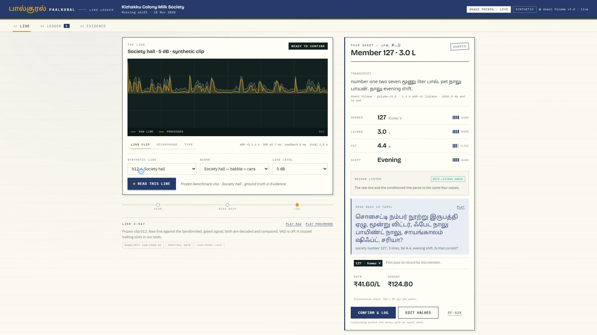
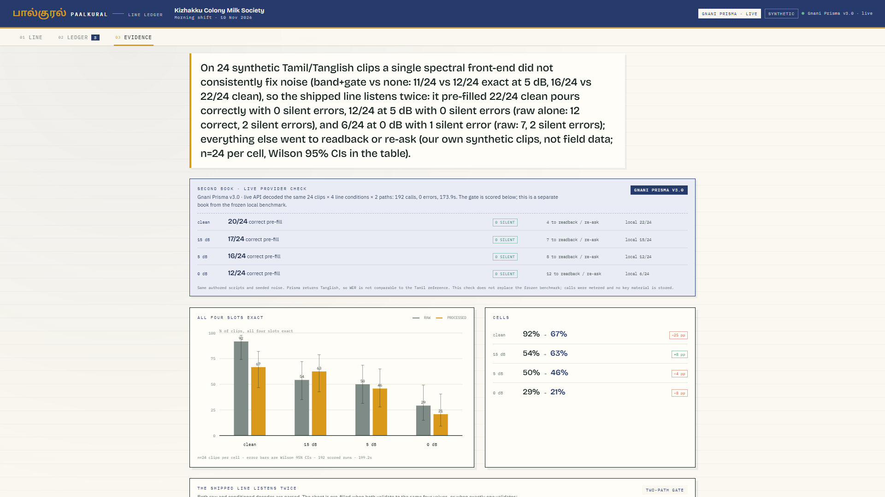

# PaalKural · பால்குரல்

A two-listen Tamil/Tanglish voice ledger for a milk collection line.
The operator speaks a pour; the line writes one confirmed entry, or refuses.

**Demo video:** [`video/out/paalkural-demo-3min.mp4`](video/out/paalkural-demo-3min.mp4) — 2 min 34 s, English narration spoken by **Gnani Timbre v2.5** (Nalini), English soft captions, real UI footage plus two concept overlays. The SRT ships as [`paalkural-demo-3min.srt`](video/out/paalkural-demo-3min.srt); the earlier 72 s cut remains at [`paalkural-demo.mp4`](video/out/paalkural-demo.mp4).

**One-page pitch:** [`submission/PaalKural-solution-pitch.pdf`](submission/PaalKural-solution-pitch.pdf) — the problem, the four-step gate, the evidence and the impact on one A4 page.

**Disclosure:** this build runs live on **Gnani Prisma v3.0 STT** and **Timbre v2.5 TTS** through a participant-supplied key. The frozen 192-run benchmark is a separate local faster-whisper run, kept local so its claim can be reproduced; a live provider check over the same matrix is reported next to it, never merged into it. Every voice, name, member number and pour in this repository is synthetic.

---

## The idea

A village milk-society line is loud, and a wrong entry is expensive: it is money paid for milk that was never poured. Most voice demos stop at a transcript. PaalKural starts where the money moves:

1. **Listen twice.** The same clip is decoded raw and after a 260–3500 Hz bandlimit plus a spectral gate.
2. **Compile, don't trust.** A deterministic compiler turns each transcript into four slots: member, litres, fat, shift. A roster and range check runs before anything is shown.
3. **Gate the write.** The sheet pre-fills only when both listens validate to the same four values (or exactly one validates). A split listen stamps **CHECK** and blocks the log.
4. **Read back in Tamil.** The operator hears the sheet read back, confirms, and the ledger stores the entry with an audit hash and a receipt that shows the heard transcript and any correction.

The Evidence Lab reports the negative result that motivated the gate: the filtered front-end did **not** win consistently on our own 24-clip benchmark. The product does not hide that; it is built around it.

## What ships



| Surface | What it does |
| --- | --- |
| **Line** (`#line`) | Clip / microphone / typed entry → dual decode → validated sheet → Tamil readback → confirm → ledger write. Shows both listens, the gate stamp, and the receive-chain flags. |
| **Ledger** (`#ledger`) | Confirmed entries only. Seed rows are marked synthetic. Each row opens a receipt with the heard transcript, correction, audit hash and provider. The day book exports as CSV for the society's accounts. |
| **Evidence** (`#evidence`) | Two labelled books: the frozen 192-run local benchmark and a separate 192-call live provider check through Gnani Prisma, each with Wilson 95% CIs and its own claim. Also the derived two-path policy table, the method and the environment. A live replay puts any clip through the configured ASR without touching the ledger. |

Gate stamps on the sheet:

- **AGREED** — both listens parsed and validated to the same four values.
- **ONE PATH** — exactly one listen validated; the sheet is pre-filled from it.
- **CHECK** — both listens validated but disagree. The log is blocked until the operator resolves the sheet.
- **RE-ASK** — neither listen passed validation. Missing or out-of-range slots are asked for in Tamil.
- **TYPED** — the ASR was deliberately bypassed; typed values still go through the same validation, readback and confirmation.

## Pipeline

```
clip / mic / typed
   → 16 kHz mono WAV
   → synthetic scene noise + 8 kHz μ-law roundtrip
   → ┬ raw          ─────────────────────────────┐
     └ band 260–3500 Hz + spectral gate ────────┤
                                                 ├→ ASR: Gnani Prisma v3.0 (live)
                                                 │        or faster-whisper medium · float16 · CUDA
                                                 │      (local default; beam 5, ta, fixed prompt, no VAD)
                                                 ├→ deterministic Tamil/Tanglish slot compiler
                                                 ├→ roster + range validation
                                                 ├→ agreement gate
                                                 ├→ Tamil readback: Gnani Timbre v2.5 (live)
                                                 │        or edge-tts ta-IN-PallaviNeural, −6%
                                                 └→ operator confirm → ledger JSON + receipt + audit hash
```

The ASR/TTS provider is chosen by the running server, and the UI states which one answered. The benchmark scripts are pinned: `tools/benchmark.py` always uses local faster-whisper, and `tools/gnani_benchmark.py` always uses Gnani Prisma.

Every turn stores both decodes and their waveforms, so the second listen is auditable rather than decorative.



## Evidence · two books

Both books use the same 24 synthetic clips × 4 line conditions × 2 arms, the same authored scripts and the same seeded noise. They differ in which ASR answered. “Exact” means all four compiled slots match the authored script.

### Book one · frozen local benchmark

192 runs, 199.2 s on the machine recorded in `data/benchmark.json`; ASR is faster-whisper medium (local, float16, CUDA).

| Condition | Arm | Exact | 95% CI | WER | Gate pass | Would auto-log wrong | ASR p50 |
| --- | --- | --- | --- | --- | --- | --- | --- |
| clean | raw | 22/24 (91.7%) | 74.2–97.7 | 25.1% | 91.7% | 0 | 809 ms |
| clean | band+gate | 16/24 (66.7%) | 46.7–82.0 | 27.4% | 70.8% | 1 | 800 ms |
| 15 dB | raw | 13/24 (54.2%) | 35.1–72.1 | 32.9% | 58.3% | 1 | 760 ms |
| 15 dB | band+gate | 15/24 (62.5%) | 42.7–78.8 | 32.2% | 70.8% | 2 | 774 ms |
| 5 dB | raw | 12/24 (50.0%) | 31.4–68.6 | 40.1% | 58.3% | 2 | 800 ms |
| 5 dB | band+gate | 11/24 (45.8%) | 27.9–64.9 | 41.5% | 50.0% | 1 | 862 ms |
| 0 dB | raw | 7/24 (29.2%) | 14.9–49.2 | 45.1% | 37.5% | 2 | 824 ms |
| 0 dB | band+gate | 5/24 (20.8%) | 9.2–40.5 | 55.8% | 25.0% | 1 | 794 ms |

The shipped line is not either arm. It decodes both and applies the gate, scored from the same runs (no third decode):

| Condition | Accepted | Exact | Silent wrong | Sent to readback / re-ask |
| --- | --- | --- | --- | --- |
| clean | 22/24 | 22/24 | 0 | 2 |
| 15 dB | 15/24 | 15/24 | 0 | 9 |
| 5 dB | 12/24 | 12/24 | 0 | 12 |
| 0 dB | 7/24 | 6/24 | 1 | 17 |

**Frozen claim** (rendered verbatim in the Evidence tab):

> On 24 synthetic Tamil/Tanglish clips a single spectral front-end did not consistently fix noise (band+gate vs none: 11/24 vs 12/24 exact at 5 dB, 16/24 vs 22/24 clean), so the shipped line listens twice: it pre-filled 22/24 clean pours correctly with 0 silent errors, 12/24 at 5 dB with 0 silent errors (raw alone: 12 correct, 2 silent errors), and 6/24 at 0 dB with 1 silent error (raw: 7, 2 silent errors); everything else went to readback or re-ask (our own synthetic clips, not field data; n=24 per cell, Wilson 95% CIs in the table).

### Book two · live provider check

192 calls through Gnani Prisma v3.0, 0 errors, 173.9 s wall clock; same clips, conditions and compiler. Prisma returns Tanglish, so WER against the Tamil scripts is not comparable and is reported but not used in the claim. This run is stored in `data/benchmark-gnani.json` and is not merged into the frozen benchmark.

| Condition | Arm | Exact | 95% CI | WER* | Gate pass | Would auto-log wrong | ASR p50 |
| --- | --- | --- | --- | --- | --- | --- | --- |
| clean | raw | 20/24 (83.3%) | 64.1–93.3 | 64.7% | 83.3% | 0 | 695 ms |
| clean | band+gate | 20/24 (83.3%) | 64.1–93.3 | 70.3% | 83.3% | 0 | 672 ms |
| 15 dB | raw | 18/24 (75.0%) | 55.1–88.0 | 70.9% | 75.0% | 0 | 682 ms |
| 15 dB | band+gate | 17/24 (70.8%) | 50.8–85.1 | 71.0% | 75.0% | 1 | 688 ms |
| 5 dB | raw | 15/24 (62.5%) | 42.7–78.8 | 71.6% | 62.5% | 0 | 675 ms |
| 5 dB | band+gate | 14/24 (58.3%) | 38.8–75.5 | 73.1% | 62.5% | 1 | 684 ms |
| 0 dB | raw | 10/24 (41.7%) | 24.5–61.2 | 72.2% | 41.7% | 0 | 686 ms |
| 0 dB | band+gate | 8/24 (33.3%) | 18.0–53.3 | 73.9% | 33.3% | 0 | 688 ms |

\* WER is against Tamil reference scripts while Prisma emits Tanglish, so it is not a like-for-like comparison.

The shipped two-path gate, scored from the same live calls:

| Condition | Accepted | Exact | Silent wrong | Sent to readback / re-ask |
| --- | --- | --- | --- | --- |
| clean | 20/24 | 20/24 | 0 | 4 |
| 15 dB | 17/24 | 17/24 | 0 | 7 |
| 5 dB | 16/24 | 16/24 | 0 | 8 |
| 0 dB | 12/24 | 12/24 | 0 | 12 |

**Live claim** (rendered verbatim in the Evidence tab):

> Live Gnani Prisma v3.0 decoded the same frozen matrix. On 24 synthetic Tamil/Tanglish clips a single spectral front-end did not consistently fix noise (band+gate vs none: 14/24 vs 15/24 exact at 5 dB, 20/24 vs 20/24 clean), so the shipped line listens twice: it pre-filled 20/24 clean pours correctly with 0 silent errors, 16/24 at 5 dB with 0 silent errors (raw alone: 15 correct, 0 silent errors), and 12/24 at 0 dB with 0 silent errors (raw: 10, 0 silent errors); everything else went to readback or re-ask (our own synthetic clips, not field data; n=24 per cell, Wilson 95% CIs in the table). Slot exactness is the comparable metric here; WER against the Tamil scripts is not comparable to Tanglish transcripts and is not used in this claim.

Known limits, copied from the two JSON artifacts:

- 24 synthetic clips per condition; each cell has n=24, not independent samples.
- All voices are TTS, not real farmers; no field audio was collected.
- The slot compiler's variant lexicon was developed while inspecting ASR output from this fixture set.
- The frozen run uses faster-whisper medium · float16 · CUDA, recorded before the participant supplied a Gnani key. The provider run uses Gnani Prisma v3.0 live and is reported separately.
- SNR is measured on active speech and set before the 8 kHz μ-law roundtrip.
- The two-path gate is scored from the same raw and conditioned runs; it adds no third decode.
- The single-pass conditioned arm is reported even though it is not the shipped path.
- Prisma returns Tanglish, so WER against the Tamil reference is not comparable and is excluded from the live claim.

WER is high because it scores the raw transcript, not the compiled slots; the compiler is what maps spoken variants to the four fields. It is reported, not hidden.

## Run it

Requires Python 3.12, ffmpeg on `PATH`, and network on first run (Whisper weights; edge-tts unless cached).

```bash
pip install faster-whisper edge-tts numpy scipy
# optional CUDA 12 wheels used by the recorded run:
pip install nvidia-cublas-cu12 nvidia-cudnn-cu12 nvidia-cuda-nvrtc-cu12

python -m server.app            # http://127.0.0.1:7860
```

- Provider mode: a key in `.env.txt` (project root or parent) or `GNANI_API_KEY` switches the run to live Prisma/Timbre. `DEMO_MODE=1` forces local faster-whisper + edge-tts; `DEMO_MODE=0` with a key forces live. With no key the app stays local. The key is never printed, logged or committed.
- The console is self-contained: fonts are served from `static/fonts` (Bricolage Grotesque, IBM Plex Sans/Mono, Noto Sans Tamil), with no external CSS or CDN calls at runtime.
- First local start downloads faster-whisper **medium** (~1.5 GB) and warms the model plus the fixed Tamil readback phrases.
- No GPU: set `DEMO_ASR_DEVICE=cpu` (int8; slower, same models).
- `DEMO_ASR_MODEL`, `DEMO_ASR_BEAM`, `DEMO_ASR_COMPUTE`, `DEMO_CHAIN`, `DEMO_TTS_VOICE` are honoured.

### Reproduce the evidence

```bash
python tools/benchmark.py        # frozen local book: 192 decodes → data/benchmark.json
python tools/gnani_benchmark.py  # live provider book: 192 calls → data/benchmark-gnani.json
```

The local script is pinned to `LocalASR`, so a loaded key cannot silently turn the frozen run into a provider run. It regenerates the same seeded noise, decodes both arms, compiles/validates, and recomputes the policy table and claim. The provider script uses the key and costs live API calls; it does not modify the frozen artifact. Timings depend on the machine.

### Tests

```bash
python -m unittest discover -s tests -v   # 26 tests
```

The suite covers parser variants from real transcripts, validation ranges, all five gate outcomes, provider-mode defaults, provider-aware TTS caching, benchmark artifact guards, and evidence-copy guards (no stale no-key disclosure, no duplicated claim prefix).

### Rebuild the demo video

The video lives in `video/`: `narration.md`, overlays, `demo-video.config.mjs`, TTS audio and VTT cues. It needs the demo-video-agent engine, Chrome and ffmpeg:

```bash
cd video
node <demo-video-agent>/engine/cli.mjs record --config demo-video.config.mjs
node <demo-video-agent>/engine/cli.mjs compose --config demo-video.config.mjs
node tools/merge-srt.mjs
```

## Layout

```
server/     stdlib HTTP app, ASR/TTS adapters, slot compiler, validation, ledger store
static/     Line console, Ledger, Evidence Lab (vanilla HTML/CSS/JS) + self-hosted fonts
fixtures/   24 benchmark WAVs + 4 demo clips + manifest.json (all synthetic)
tools/      local benchmark, live provider check, fixture generation, probes, UI capture
tests/      26 unit tests for parser, validation, gate, providers, ledger export and evidence copy
data/       benchmark.json, benchmark-gnani.json, ledger.json, receipts, shots, TTS cache
video/      narration, overlays, config, captions, final mp4
```

## Demo path in the video

1. **b12 at 5 dB** — babble and cans; both live Prisma listens agree on 127 · 3.0 L · 4.4% · evening; the sheet pre-fills; the operator confirms the Tamil readback and writes receipt `E-DAF88B` (audit hash `5ceb0f2a3875`).
2. **b05 at 15 dB** — raw hears fat 4.7, the conditioned listen hears 4.0; both pass validation, so the sheet stamps CHECK and blocks the log. The operator keeps the raw value (4.7), saves, and receipt `E-0907AE` lands with audit hash `5a9ea86add4a` and amount ₹107.00 instead of a silent entry.
3. **Evidence** — the frozen local book, the live provider check (192 calls, 0 errors, 0 silent wrong in its gate), the chart and the two-path policy table.
4. **Outro** — live Prisma/Timbre through a participant-supplied key; the frozen benchmark stays local; synthetic voices and pours.

The clip IDs, conditions and ground truth come from `fixtures/manifest.json`; the benchmark clips are the same ones shown in the Evidence tab.

## Integrity

- Synthetic voices, names, member numbers and pours. No real farmer, phone number, Aadhaar, PAN, account number or recorded call.
- The demo runs Gnani Prisma/Timbre live with a participant-supplied key; the UI, receipts and health endpoint state the active provider. The frozen benchmark and its claim remain local faster-whisper runs, and the key is never logged or committed.
- No bought engagement, bots, paid promotion or engagement swaps. One entry.
- Every number shown is produced by a committed script and stored in `data/benchmark.json` or `data/benchmark-gnani.json`; each claim is limited to our own 24 synthetic clips.
- The product deliberately reports a negative result and a filter path that is not the winner. The gate, not the filter, is the contribution.
